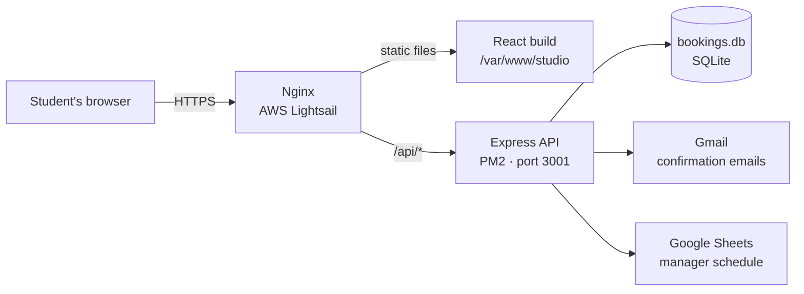

<div align="center">

# The Studio at Colby

**A booking platform for Colby College's student-run recording studio.**

Students pick a day, choose an open time slot with a student engineer, and get a confirmation email. Managers see every booking in a shared Google Sheet.


[Live site](https://thestudioatcolby.org/) · [Architecture](#architecture) · [Run locally](#running-locally) · [Deploy](#deploying-updates) · [Maintenance](#maintenance-guide)

</div>

---

## Highlights

- **Full-stack booking flow.** A React calendar and time-slot picker on the frontend, and an Express + SQLite API on the backend.
- **No double bookings.** `start_time` is `UNIQUE` in the database, so two people can't book the same slot even if they submit at the same moment. When a slot is taken, the frontend refreshes availability and greys it out.
- **Forms remember your answers.** Booking details are saved in `localStorage`, so a refresh doesn't wipe a half-finished form. Saved dates that have passed are cleared on load.
- **Bookings reach the people who need them.** Each booking is saved to the database, emailed to the student, and added to a Google Sheet the managers already use.
- **Fast and accessible.** Pages are lazy-loaded, motion respects `prefers-reduced-motion`, and the forms and carousels support the keyboard.
- **Production deployment.** Nginx serves the React build and proxies the API on AWS Lightsail. PM2 keeps the server running, and a one-command deploy script handles updates.

---

## Architecture



The frontend and backend run on the **same server and domain**. The React app calls relative URLs like `/api/bookings`. Nginx serves the built frontend files and forwards anything under `/api/` to Express. Because everything is on one domain, there's no CORS setup to manage.

---

## Project structure

```
Colby-Studio/
├── colby-studio-web/          # Frontend (React + Vite)
│   ├── src/
│   │   ├── pages/             # One file per route
│   │   ├── components/        # Reusable sections (Navbar, Footer, carousels…)
│   │   ├── styles/            # One CSS file per page/component
│   │   ├── assets/            # Logos, images
│   │   ├── App.jsx            # Routes + page transitions
│   │   └── index.css          # Global colors, fonts, base styles
│   └── vite.config.js
│
├── server/                    # Backend (Node + Express)
│   ├── index.js               # Starts the API, mounts routes
│   ├── env.js                 # Loads .env (must be imported first)
│   ├── routes/
│   │   ├── availability.js    # GET open time slots for a date
│   │   ├── bookings.js        # POST a studio session booking
│   │   ├── eventBookings.js   # POST a live-recording / event request
│   │   └── contact.js         # POST a contact-form message
│   ├── db.js                  # Opens bookings.db and creates tables
│   ├── bookings.db            # SQLite database 
│   └── .env                   # Secrets (git-ignored)
│
└── asset-library/             # Brand assets
```

### Frontend pages

| Route | File | Purpose |
|---|---|---|
| `/` | `pages/Home.jsx` | Hero, info, how it works, music carousel, contact |
| `/about` | `pages/About.jsx` | Editorial page about the studio, engineers, Mix Club |
| `/booking` | `pages/BookingsPage.jsx` | Choose between studio time and a special request |
| `/studio-booking` | `pages/Booking.jsx` | Calendar, time slots, and booking form |
| `/special-request` | `pages/Request.jsx` | Live recording / event request form |
| `/privacy-policy` | `pages/PrivacyPolicy.jsx` | How booking data is stored and used |

### API endpoints

| Method | Endpoint | Description |
|---|---|---|
| `GET` | `/api/availability?date=YYYY-MM-DD` | Returns that day's slots: `[{ start, manager, available }]` |
| `POST` | `/api/bookings` | Creates a session booking, emails the student, and adds it to the Sheet |
| `POST` | `/api/eventbookings` | Creates an event / live recording request |
| `POST` | `/api/contact` | Sends a contact-form message |

### Database

The `bookings` table in `server/bookings.db`:

| Column | Type | Notes |
|---|---|---|
| `id` | INTEGER | Primary key |
| `start_time` | TEXT | ISO timestamp, **UNIQUE** (prevents double booking) |
| `name`, `email` | TEXT | Required |
| `music_major` | TEXT | `major` · `minor` · `undecided` · `neither` |
| `to_accomplish` | TEXT | Required session description |
| `equipment`, `reference_tracks` | TEXT | Optional |
| `created_at` | TEXT | Set automatically |

Tables are created automatically on first run (`CREATE TABLE IF NOT EXISTS`), so a new server needs no migration step.

---

## Configuration

The backend reads its settings from `server/.env`. This file is **never committed**. Ask the current maintainer for the values, or make your own for local development.

<!-- TODO: make sure these names match the variables in server/env.js and your route files -->

| Variable | What it's for |
|---|---|
| `PORT` | Port the API listens on (`3001`; must match the Nginx `proxy_pass`) |
| `GMAIL_USER` | Gmail address that has access to the group email |
| `STUDIO_EMAIL` | Gmail address that sends confirmation emails |
| `SECRETARY_EMAIL` | Gmail address of the secretary that als gets all communications|
| `GMAIL_APP_PASSWORD` | Gmail **app password** for GMAIL_USER (not the account password) |
| `GOOGLE_SCRIPT_URL` | URL to the Google SHeet |


---

## Running locally

**Requirements:** Node.js 22+ and npm.

```bash
git clone https://github.com/USERNAME/Colby-Studio.git
cd Colby-Studio

# Backend
cd server
npm install
cp .env.example .env        # then fill in the values
npm start                   # → API on 127.0.0.1:3001

# Frontend (new terminal)
cd colby-studio-web
npm install
npm run dev                 # → http://localhost:5173

# OR Combined
cd Colby-Studio
npm run dev                 # starts the frontend and backend
```

The Vite dev server proxies `/api` to `localhost:3001`, so the frontend and backend talk to each other the same way they do in production.

**Test a production build locally:**

```bash
cd colby-studio-web
npm run build && npm run preview
```

---

## Deploying updates

Production runs on an **AWS Lightsail** Ubuntu 24.04 instance.

| Piece | Location / tool |
|---|---|
| Code | `~/Colby-Studio` (cloned from GitHub) |
| Frontend build | `/var/www/studio` (served by Nginx) |
| API process | PM2, process name `studio-api` |
| Nginx config | `/etc/nginx/sites-available/studio` |
| Deploy script | `~/deploy.sh` |

### The two-step deploy

**1. On your machine:** commit and push.

```bash
git add .
git commit -m "describe your change"
git push
```

**2. On the server** (Lightsail → *Connect using SSH*):

```bash
~/deploy.sh
```

The script pulls the latest code, installs dependencies, restarts the API, rebuilds the frontend, and publishes it. When it prints **Deployed.**, hard-refresh the site.

<details>
<summary><b>What's inside <code>deploy.sh</code></b></summary>

```bash
#!/bin/bash
set -e
cd ~/Colby-Studio && git pull
cd server && npm ci --omit=dev && pm2 restart studio-api --update-env
cd ../colby-studio-web && npm ci && npm run build
sudo rm -rf /var/www/studio/* && sudo cp -r dist/* /var/www/studio/
echo "Deployed."
```

</details>

### What deploys don't touch

- **`server/.env`.** Edit it on the server with `nano ~/Colby-Studio/server/.env`, then run `pm2 restart studio-api --update-env`.
- **`bookings.db`.** The server copy is the real data. Local copies are for testing only.
- **The Nginx config.** It only changes if you edit it on the server.

> ⚠️ **Never edit code directly on the server.** Make every change locally and push it, or `git pull` will conflict.

---

## Maintenance guide

### Common tasks

| Task | Where |
|---|---|
| Change colors or fonts site-wide | `colby-studio-web/src/index.css` (`:root` variables) |
| Add or edit an engineer | `ENGINEERS` array in `pages/About.jsx` |
| Change which days can be booked | `disabled` prop on `<DayPicker>` in `pages/Booking.jsx` |
| Change available time slots | `server/routes/availability.js` |
| Edit the confirmation email | `server/routes/bookings.js` or `server/routes/eventBookings.js` or `server/routes/contact.js`  |
| Add a page | Create `pages/NewPage.jsx`, add a lazy import and `<Route>` in `App.jsx`, link it in `Footer.jsx` and `Navbar.jsx` |
| Add a footer link | `COLUMNS` array in `components/Footer.jsx` |

### Server commands

```bash
pm2 status                         # is the API running?
pm2 logs studio-api --lines 50     # recent output and errors (Ctrl+C to exit)
pm2 restart studio-api             # restart the API
pm2 monit                          # live CPU / memory

sudo nginx -t                      # check Nginx config
sudo systemctl reload nginx        # apply Nginx changes
sudo tail -50 /var/log/nginx/error.log

free -h                            # memory ("available" is what matters)
```

### Backups

- **Automatic:** Lightsail takes a daily snapshot of the whole instance (Instance → *Snapshots*).
- **Manual copy of the database:**
  ```bash
  sqlite3 ~/Colby-Studio/server/bookings.db ".backup ~/bookings-$(date +%F).db"
  ```

### Troubleshooting

| Symptom | Likely cause | Fix |
|---|---|---|
| **502 Bad Gateway** | API isn't running | `pm2 logs studio-api`, fix the error, `pm2 restart studio-api` |
| Booking fails, page loads fine | Missing `.env` value or Sheets permission | Check `pm2 logs`; confirm the Sheet is shared with the service account |
| Emails don't send | Wrong app password, or port 25 | Use a Gmail **app password** on port **587** (Lightsail blocks 25) |
| Refreshing `/about` gives 404 | Missing SPA fallback | Nginx needs `try_files $uri $uri/ /index.html;` |
| Changes don't appear | Browser cache | Hard-refresh (Cmd/Ctrl + Shift + R) |
| `git pull` fails in deploy | Files were edited on the server | `cd ~/Colby-Studio && git checkout -- .`, then redeploy |
| `npm ci` fails on `better-sqlite3` | Missing build tools | `sudo apt install -y build-essential python3` |
| Build "Killed" / out of memory | Not enough RAM | Add swap space, or upgrade the Lightsail plan |

---

## Tech stack

**Frontend:** React · Vite · React Router · Framer Motion · react-day-picker · date-fns · react-icons
**Backend:** Node.js · Express · better-sqlite3 · dotenv · Gmail SMTP · Google Sheets API
**Infrastructure:** AWS Lightsail (Ubuntu 24.04) · Nginx · PM2 · Let's Encrypt (Certbot)

---

<div align="center">

Designed and built by **Alexander Duan** for The Studio at Colby.

</div>
