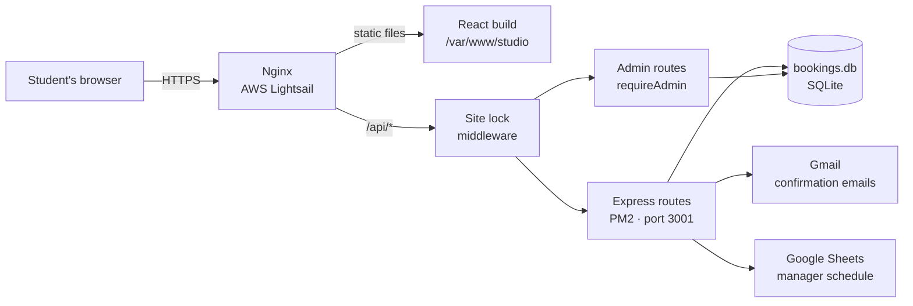

<div align="center">

# The Studio at Colby

**A booking platform for Colby College's student-run recording studio.**

Students pick a day, choose an open time slot with a student engineer, and get a confirmation email. Managers see every booking in a shared Google Sheet and can review or remove bookings from a password-protected admin page.


[Live site](https://thestudioatcolby.org/) · [Architecture](#architecture) · [Security](#security) · [Run locally](#running-locally) · [Deploy](#deploying-updates) · [Maintenance](#maintenance-guide)

</div>

---

## Highlights

- **Full-stack booking flow.** A React calendar and time-slot picker on the frontend, and an Express + SQLite API on the backend.
- **No double bookings.** `start_time` is `UNIQUE` in the database, so two people can't book the same slot even if they submit at the same moment. When a slot is taken, the frontend refreshes availability and greys it out.
- **Forms remember your answers.** Booking details are saved in `localStorage`, so a refresh doesn't wipe a half-finished form. Saved dates that have passed are cleared on load.
- **Bookings reach the people who need them.** Each booking is saved to the database, emailed to the student, and added to a Google Sheet the managers already use.
- **Admin dashboard.** A password-protected `/admin` page lists every session and event booking, shows each one in full, and can delete them.
- **Site lock for development.** While the site is under construction, the whole site and API sit behind a password checked on the server.
- **Fast and accessible.** Pages are lazy-loaded, motion respects `prefers-reduced-motion`, and the forms and carousels support the keyboard.
- **Production deployment.** Nginx serves the React build and proxies the API on AWS Lightsail. PM2 keeps the server running, and a one-command deploy script handles updates.

---

## Architecture



The frontend and backend run on the **same server and domain**. The React app calls relative URLs like `/api/bookings`. Nginx serves the built frontend files and forwards anything under `/api/` to Express. Because everything is on one domain, there's no CORS setup to manage, and cookies set by the API work across the whole site.

Every API request passes through the middleware in this order:

1. `express.json()` parses the request body.
2. `/api/unlock` lets visitors check or enter the site password.
3. `requireUnlock` blocks every other `/api` route unless the visitor has unlocked the site.
4. `/api/admin/auth` handles admin sign-in and sign-out.
5. `/api/admin` routes run `requireAdmin` first, so they need an admin session.
6. The public routes (`availability`, `bookings`, `eventbookings`, `contact`) handle the request.

---

## Project structure

```
Colby-Studio/
├── colby-studio-web/          # Frontend (React + Vite)
│   ├── src/
│   │   ├── pages/             # One file per route
│   │   ├── components/        # Reusable sections (Navbar, Footer, SiteGate, carousels…)
│   │   ├── styles/            # One CSS file per page/component
│   │   ├── assets/            # Logos, images
│   │   ├── App.jsx            # Routes, page transitions, SiteGate wrapper
│   │   └── index.css          # Global colors, fonts, base styles
│   └── vite.config.js
│
├── server/                    # Backend (Node + Express)
│   ├── index.js               # Starts the API, mounts middleware and routes
│   ├── env.js                 # Loads .env (must be imported first)
│   ├── middleware/
│   │   ├── siteLock.js        # Site-wide password lock (remove at launch)
│   │   └── adminAuth.js       # Admin login, sessions, rate limiting
│   ├── routes/
│   │   ├── availability.js    # GET open time slots for a date
│   │   ├── bookings.js        # POST a studio session booking
│   │   ├── eventBookings.js   # POST a live-recording / event request
│   │   ├── contact.js         # POST a contact-form message
│   │   └── admin.js           # List, inspect and delete bookings (admin only)
│   ├── db.js                  # Opens bookings.db and creates tables
│   ├── bookings.db            # SQLite database
│   └── .env                   # Secrets (git-ignored)
│
└── asset-library/             # Brand assets
```

### Frontend pages

| Route | File | Purpose |
|---|---|---|
| `/` | `pages/Home.jsx` | Hero, info, how it works, music carousel, contact |
| `/about` | `pages/About.jsx` | Editorial page about the studio, engineers, Mix Club |
| `/archive` | `pages/Archive.jsx` | News coverage and embedded Samply playlists |
| `/booking` | `pages/BookingsPage.jsx` | Choose between studio time and a special request |
| `/studio-booking` | `pages/Booking.jsx` | Calendar, time slots, and booking form |
| `/special-request` | `pages/Request.jsx` | Live recording / event request form |
| `/privacy-policy` | `pages/PrivacyPolicy.jsx` | How booking data is stored and used |
| `/admin` | `pages/Admin.jsx` | Password-protected dashboard to view and delete bookings |

`components/SiteGate.jsx` wraps the whole app in `App.jsx` and shows a password screen until the site is unlocked.

### API endpoints

**Public** (need the site to be unlocked while the site lock is on):

| Method | Endpoint | Description |
|---|---|---|
| `GET` | `/api/availability?date=YYYY-MM-DD` | Returns that day's slots: `[{ start, manager, available }]` |
| `POST` | `/api/bookings` | Creates a session booking, emails the student, and adds it to the Sheet |
| `POST` | `/api/eventbookings` | Creates an event / live recording request |
| `POST` | `/api/contact` | Sends a contact-form message |

**Site lock** (always reachable):

| Method | Endpoint | Description |
|---|---|---|
| `GET` | `/api/unlock` | Returns `{ ok: true }` if this browser has unlocked the site |
| `POST` | `/api/unlock` | Body `{ password }`. Sets the `site_gate` cookie if the password is correct |

**Admin:**

| Method | Endpoint | Description |
|---|---|---|
| `GET` | `/api/admin/auth/session` | Returns `{ ok: true }` if signed in as admin |
| `POST` | `/api/admin/auth/login` | Body `{ password }`. Starts an 8-hour admin session |
| `POST` | `/api/admin/auth/logout` | Ends the admin session |
| `GET` | `/api/admin/types` | Lists the booking types the dashboard can show (`sessions`, `events`) |
| `GET` | `/api/admin/:type` | Every row of that type, newest first |
| `GET` | `/api/admin/:type/:id` | One row in full |
| `DELETE` | `/api/admin/:type/:id` | Deletes one row |

### Database

The `bookings` table in `server/bookings.db`:

| Column | Type | Notes |
|---|---|---|
| `id` | INTEGER | Primary key (the admin page uses it to inspect and delete) |
| `start_time` | TEXT | ISO timestamp, **UNIQUE** (prevents double booking) |
| `name`, `email` | TEXT | Required |
| `music_major` | TEXT | `major` · `minor` · `undecided` · `neither` |
| `to_accomplish` | TEXT | Required session description |
| `equipment`, `reference_tracks` | TEXT | Optional |
| `created_at` | TEXT | Set automatically |

Tables are created automatically on first run (`CREATE TABLE IF NOT EXISTS`), so a new server needs no migration step.

---

## Security

The site has two separate password layers, both checked on the server. No password is ever stored in the React code, because anything in the frontend bundle can be read by anyone in their browser's DevTools.

### Site lock (`middleware/siteLock.js`)

Blocks the whole site while it's under construction.

1. When the app loads, `SiteGate` calls `GET /api/unlock`. If the answer is `ok: false`, it shows a password screen instead of the site.
2. The visitor submits the password to `POST /api/unlock`. The server compares it with `SITE_PASSWORD` using `crypto.timingSafeEqual`, so how long the check takes reveals nothing about how close a guess was.
3. If it matches, the server sets a `site_gate` cookie. Its value is a SHA-256 hash derived from the password, so the password itself is never sent back to the browser.
4. `requireUnlock` runs before every other `/api` route and rejects any request without a valid cookie with `401`. This means bookings and contact messages can't be submitted during testing, even by someone who bypasses the React screen.

The cookie lasts **30 days**, so reloading the page or coming back later keeps the site unlocked. To lock it again, delete the `site_gate` cookie in DevTools (Application → Cookies) or use a private window. Changing `SITE_PASSWORD` and restarting the API signs out every browser at once, because every existing cookie stops matching.

**Limits:** Nginx still serves the built JavaScript files directly, so a determined visitor could read the frontend code. It contains no secrets. For a full lock, use Nginx basic auth (`auth_basic`) instead.

### Admin login (`middleware/adminAuth.js`)

Protects the `/admin` page and the `/api/admin` routes.

1. The admin submits the password to `POST /api/admin/auth/login`, which compares it with `ADMIN_PASSWORD` the same timing-safe way.
2. If it matches, the server creates a **random 256-bit session token**, keeps it in memory with an expiry time, and sets it as the `admin_session` cookie. Unlike the site lock, the token has nothing to do with the password, and each login gets a new one.
3. `requireAdmin` runs before every admin route and checks that the cookie holds a known, unexpired token.
4. Sessions expire after **8 hours**, and signing out deletes the token on the server. Restarting the API signs every admin out, because sessions live only in memory.
5. **Rate limiting:** after 5 wrong passwords from the same IP address, logins are refused for 15 minutes. `app.set('trust proxy', 1)` in `index.js` makes `req.ip` the visitor's real address instead of Nginx's.

Admins also need to pass the site lock first, because the admin routes are mounted after `requireUnlock`.

### Safe database access (`routes/admin.js`)

- Values such as `id` are passed as SQL parameters (`WHERE id = ?`), never pasted into the query, which prevents SQL injection.
- Table names can't be parameters, so the admin routes only accept types from a fixed allowlist (`sessions` → `bookings`, `events` → `event_bookings`). Any other type returns `404`.

### Cookie settings

Both cookies are set with:

| Setting | Why |
|---|---|
| `httpOnly` | JavaScript on the page can't read the cookie, so a script injected into the page can't steal it |
| `sameSite: 'strict'` | The browser won't send the cookie on requests started by other websites |
| `secure` (when `NODE_ENV=production`) | The cookie is only sent over HTTPS, never over plain HTTP |

### Network

- The API binds to `HOST=127.0.0.1`, so it only accepts connections from the server itself. The only way in from the internet is through Nginx over HTTPS (Let's Encrypt).
- Secrets live only in `server/.env`, which is git-ignored and never deployed by the deploy script.

---

## Configuration

The backend reads its settings from `server/.env`. This file is **never committed**. Ask the current maintainer for the values, or make your own for local development.

Variable names are case-sensitive on Linux, so they must match the names the code reads exactly.

| Variable | What it's for |
|---|---|
| `PORT` | Port the API listens on (`3001`; must match the Nginx `proxy_pass`) |
| `HOST` | Address the API binds to. Defaults to `127.0.0.1`, so the API only accepts connections from the server itself (through Nginx) and isn't reachable directly from the internet |
| `GMAIL_USER` | Gmail address that has access to the group email |
| `STUDIO_EMAIL` | Gmail address that sends confirmation emails |
| `SECRETARY_EMAIL` | Gmail address of the secretary, who also gets all communications |
| `GMAIL_APP_PASSWORD` | Gmail **app password** for `GMAIL_USER` (not the account password) |
| `GOOGLE_SCRIPT_URL` | URL to the Google Sheet |
| `SITE_PASSWORD` | Password to the site while under construction (read by `middleware/siteLock.js`) |
| `ADMIN_PASSWORD` | Password to the admin page (read by `middleware/adminAuth.js`). Keep it different from `SITE_PASSWORD`, so testers with the site password can't open the admin page |
| `NODE_ENV` | Set to `production` on the live server only. Makes the site-lock and admin cookies HTTPS-only (`Secure`) and hides detailed error messages. Leave unset for local development |

The API refuses to start if `SITE_PASSWORD` or `ADMIN_PASSWORD` is missing, so a typo shows up immediately in `pm2 logs`.

---

## Running locally

**Requirements:** Node.js 22+ and npm.

```bash
git clone https://github.com/USERNAME/Colby-Studio.git
cd Colby-Studio

# Backend
cd server
npm install
cp .env.example .env        # then fill in the values
npm start                   # → API on 127.0.0.1:3001

# Frontend (new terminal)
cd colby-studio-web
npm install
npm run dev                 # → http://localhost:5173

# OR Combined
cd Colby-Studio
npm run dev                 # starts the frontend and backend
```

The Vite dev server proxies `/api` to `localhost:3001`, so the frontend and backend talk to each other the same way they do in production, and the site-lock and admin cookies work locally too.

**Test a production build locally:**

```bash
cd colby-studio-web
npm run build && npm run preview
```

---

## Deploying updates

Production runs on an **AWS Lightsail** Ubuntu 24.04 instance.

| Piece | Location / tool |
|---|---|
| Code | `~/Colby-Studio` (cloned from GitHub) |
| Frontend build | `/var/www/studio` (served by Nginx) |
| API process | PM2, process name `studio-api` |
| Nginx config | `/etc/nginx/sites-available/studio` |
| Deploy script | `~/deploy.sh` |

### The two-step deploy

**1. On your machine:** commit and push.

```bash
git add .
git commit -m "describe your change"
git push
```

**2. On the server** (Lightsail → *Connect using SSH*):

```bash
~/deploy.sh
```

The script pulls the latest code, installs dependencies, restarts the API, rebuilds the frontend, and publishes it. When it prints **Deployed.**, hard-refresh the site.

Restarting the API signs out every admin, because admin sessions live in memory. Site-lock cookies keep working.

<details>
<summary><b>What's inside <code>deploy.sh</code></b></summary>

```bash
#!/bin/bash
set -e
cd ~/Colby-Studio && git pull
cd server && npm ci --omit=dev && pm2 restart studio-api --update-env
cd ../colby-studio-web && npm ci && npm run build
sudo rm -rf /var/www/studio/* && sudo cp -r dist/* /var/www/studio/
echo "Deployed."
```

</details>

### What deploys don't touch

- **`server/.env`.** Edit it on the server with `nano ~/Colby-Studio/server/.env`, then run `pm2 restart studio-api --update-env`.
- **`bookings.db`.** The server copy is the real data. Local copies are for testing only.
- **The Nginx config.** It only changes if you edit it on the server.

> ⚠️ **Never edit code directly on the server.** Make every change locally and push it, or `git pull` will conflict.

### Launch checklist: removing the site lock

When the site is ready for the public:

1. Delete `server/middleware/siteLock.js`.
2. In `server/index.js`, delete its import and the two lines `app.use('/api/unlock', unlockRoutes);` and `app.use('/api', requireUnlock);`.
3. In `App.jsx`, remove the `<SiteGate>` wrapper and its import, then delete `components/SiteGate.jsx` and `SiteGate.css`.
4. Remove `SITE_PASSWORD` from `server/.env`.
5. Push and run `~/deploy.sh`.

The admin login keeps working on its own after the site lock is gone.

---

## Maintenance guide

### Common tasks

| Task | Where |
|---|---|
| Change colors or fonts site-wide | `colby-studio-web/src/index.css` (`:root` variables) |
| Add or edit an engineer | `ENGINEERS` array in `pages/About.jsx` |
| Add a news story or playlist | `NEWS` and `PLAYLISTS` arrays in `pages/Archive.jsx` |
| Change which days can be booked | `disabled` prop on `<DayPicker>` in `pages/Booking.jsx` |
| Change available time slots | `server/slots.js` |
| Edit the confirmation email | `server/routes/bookings.js`, `server/routes/eventBookings.js` or `server/routes/contact.js` |
| Show another table on the admin page | Add it to the `TABLES` allowlist in `server/routes/admin.js` |
| Change the site or admin password | Edit `server/.env`, then `pm2 restart studio-api --update-env` |
| Change how long logins last | `maxAge` in `siteLock.js` (30 days) or `SESSION_MS` in `adminAuth.js` (8 hours) |
| Add a page | Create `pages/NewPage.jsx`, add a lazy import and `<Route>` in `App.jsx`, link it in `Footer.jsx` and `Navbar.jsx` |
| Add a footer link | `COLUMNS` array in `components/Footer.jsx` |

> Deleting a booking on the admin page only removes the database row. It doesn't remove the row from the Google Sheet or email the student.

### Server commands

```bash
pm2 status                         # is the API running?
pm2 logs studio-api --lines 50     # recent output and errors (Ctrl+C to exit)
pm2 restart studio-api             # restart the API
pm2 monit                          # live CPU / memory

sudo nginx -t                      # check Nginx config
sudo systemctl reload nginx        # apply Nginx changes
sudo tail -50 /var/log/nginx/error.log

free -h                            # memory ("available" is what matters)
```

### Backups

- **Automatic:** Lightsail takes a daily snapshot of the whole instance (Instance → *Snapshots*).
- **Manual copy of the database:**
  ```bash
  sqlite3 ~/Colby-Studio/server/bookings.db ".backup ~/bookings-$(date +%F).db"
  ```

Take a manual backup before deleting a lot of bookings from the admin page, because deletes can't be undone.

### Troubleshooting

| Symptom | Likely cause | Fix |
|---|---|---|
| **502 Bad Gateway** | API isn't running | `pm2 logs studio-api`, fix the error, `pm2 restart studio-api` |
| API crashes with "missing from .env" | `SITE_PASSWORD` or `ADMIN_PASSWORD` not set, or the name's case doesn't match | Fix `server/.env`, then `pm2 restart studio-api --update-env` |
| Password screen won't go away | Wrong password, or the cookie isn't being saved | Check the password; in DevTools → Application → Cookies, confirm `site_gate` appears |
| Site stays unlocked after reload | Expected: the cookie lasts 30 days | Delete the `site_gate` cookie or use a private window to test the locked state |
| Admin page says "Too many attempts" | 5 wrong passwords in 15 minutes | Wait 15 minutes, or restart the API to clear the counter |
| Signed out of admin unexpectedly | Session expired (8 hours) or the API restarted | Sign in again |
| Cookies not saved locally | `NODE_ENV=production` set in the local `.env` | Remove it locally; Secure cookies need HTTPS |
| Booking fails, page loads fine | Missing `.env` value or Sheets permission | Check `pm2 logs`; confirm the Sheet is shared with the service account |
| Emails don't send | Wrong app password, or port 25 | Use a Gmail **app password** on port **587** (Lightsail blocks 25) |
| Refreshing `/about` gives 404 | Missing SPA fallback | Nginx needs `try_files $uri $uri/ /index.html;` |
| Changes don't appear | Browser cache | Hard-refresh (Cmd/Ctrl + Shift + R) |
| `git pull` fails in deploy | Files were edited on the server | `cd ~/Colby-Studio && git checkout -- .`, then redeploy |
| `npm ci` fails on `better-sqlite3` | Missing build tools | `sudo apt install -y build-essential python3` |
| Build "Killed" / out of memory | Not enough RAM | Add swap space, or upgrade the Lightsail plan |

---

## Tech stack

**Frontend:** React · Vite · React Router · Framer Motion · react-day-picker · date-fns · react-icons
**Backend:** Node.js · Express · better-sqlite3 · dotenv · Node `crypto` · Gmail SMTP · Google Sheets API
**Infrastructure:** AWS Lightsail (Ubuntu 24.04) · Nginx · PM2 · Let's Encrypt (Certbot)

---

<div align="center">

Designed and built by **Alexander Duan** for The Studio at Colby.

</div>
